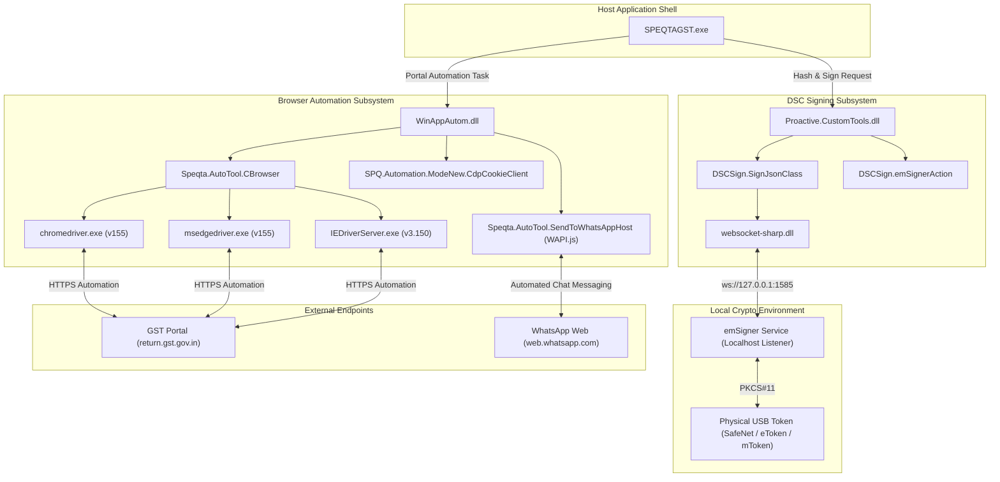
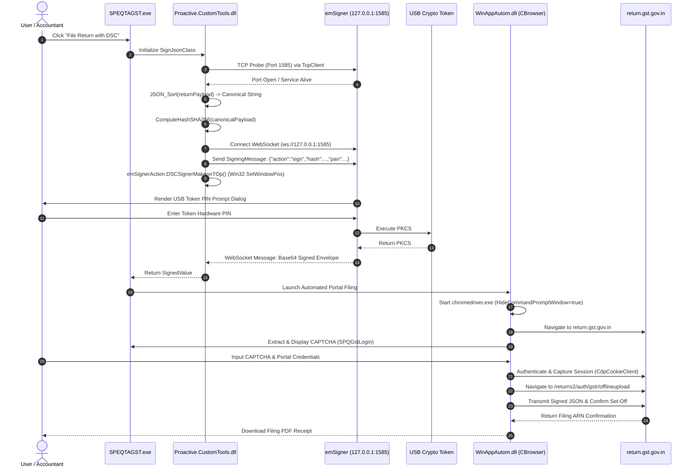

# Technical & Defensive Security Review: Portal Automation & Hardware DSC Signing

> **Target Binaries:**  
> - `01_APPLICATION\Proactive.CustomTools.dll` (109,896 bytes, .NET 4.0/4.5)  
> - `01_APPLICATION\WinAppAutom.dll` (7,579,976 bytes, .NET 4.0/4.5)  
> - `01_APPLICATION\websocket-sharp.dll` (261,632 bytes)  
> - Bundled Drivers: `chromedriver.exe` (v155), `msedgedriver.exe` (v155), `IEDriverServer.exe` (v3.150)  
> **Methodology:** Static .NET metadata inspection, IL instruction analysis, and pre-harvested string correlation  
> **Classification:** Defensive Architectural & Threat Surface Analysis  

---

## 1. Executive Summary

In Indian GST compliance workflows, filing valid returns requires two critical operational capabilities:
1. **Cryptographic Authentication:** Legally binding digital signatures executed via physical USB hardware tokens (Digital Signature Certificates / DSC).
2. **Portal Interaction:** Automated navigation, authentication, CAPTCHA handling, and payload transmission against `return.gst.gov.in`.

This review analyzes how SPEQTA GST implements these mechanisms through `Proactive.CustomTools.dll` (DSC signing client) and `WinAppAutom.dll` (Selenium WebDriver automation suite). 

### Key Findings:
- **Localhost WebSocket Interfacing (`Proactive.CustomTools.dll`):** DSC signing does not directly interface with PKCS#11 hardware drivers. Instead, it acts as a WebSocket client (`websocket-sharp`) connecting to the local eMudhra / GSTN `emSigner` background service listening on `127.0.0.1:1585`.
- **Inter-Process Vulnerability Surface:** The local WebSocket channel lacks client authentication and Origin verification, creating exposures to Cross-Site WebSocket Hijacking (CSWSH) and local token signature abuse.
- **Multi-Browser WebDriver Orchestration (`WinAppAutom.dll`):** Browser automation coordinates Chrome, Edge, and IE through hidden driver console instances, utilizing custom profile directories (`UserDataPath_`), Chrome DevTools Protocol (`CdpCookieClient`) for cookie interception, and DOM-based CAPTCHA extraction.
- **Dual Automation Purpose:** In addition to government portal filing, `WinAppAutom.dll` embeds a complete WhatsApp Web automation library (`WAPI.js`) used for broadcasting invoices and return confirmations to clients.

---

## 2. System Architecture & Coordination Workflow

The following component and sequence diagrams illustrate how the core application shell coordinates `Proactive.CustomTools.dll`, local cryptographic services, browser drivers, and the government portal.

### 2.1 Component Architecture



### 2.2 End-to-End Filing & Signing Sequence



---

## 3. Hardware DSC Signing Architecture (`Proactive.CustomTools.dll`)

### 3.1 Metadata & Public Interface Inventory

Static inspection of `Proactive.CustomTools.dll` identifies two primary classes responsible for hardware token operations:

```csharp
namespace DSCSign
{
    public class SignJsonClass
    {
        // Properties
        public string SignedValue { get; set; }
        public string JsonError { get; set; }

        // Localhost Port Probing
        public bool CheckEmsigner();
        public bool CheckEmsignerAvailablePort(int portno);

        // Core Signing Pipelines
        public void WebSocket(string strHash, string strPAN);
        public void WebSocket(string strHash, string strPAN, string PortNo);
        public void WebSocket9C(string strjson, string hashFilepath, string sortFilepath, string stringFilepath);

        // Pre-processing & Cryptography
        public void JSON_Sort(JObject json);
        public string ConvertJsonToString(JObject sortedJson);
        public string ComputeHashSHA256(string rawData);
        public string SigningMessage(string strHash, string strPAN);
        public bool DSCSignerMakeonTOp();
    }

    public class emSignerAction
    {
        // Win32 Interop for Process/Window Orchestration
        public static int FindWindow(string lpClassName, string lpWindowName);
        public static int SendMessage(int hWnd, uint Msg, int wParam, int lParam);
        public static bool SetWindowPos(int hWnd, IntPtr hWndInsertAfter, int X, int Y, int cx, int cy, int uFlags);

        // Lifecycle Management
        public bool CheckDSCSignerOpen();
        public bool CheckEmSignerOpen();
        public bool CloseAnyApp(string AppWindowName);
        public void CloseEmsigner();
    }
}
```

### 3.2 Canonicalization, Hashing & Protocol Pipeline

1. **JSON Canonicalization (`JSON_Sort` & `ConvertJsonToString`):**
   Indian GST JSON payloads must be deterministically ordered before hashing; otherwise, differing key orders invalidate cryptographic verification. `SignJsonClass.JSON_Sort` recursively traverses `Newtonsoft.Json.Linq.JObject` structures, alphabetically ordering properties and stripping unnecessary whitespace before serialization.
2. **Hash Generation (`ComputeHashSHA256`):**
   The canonical string is converted to UTF-8 bytes and hashed using `System.Security.Cryptography.SHA256.Create()`. The resulting 32-byte hash is formatted into a hexadecimal string.
3. **Transport Handshake (`CheckEmsigner`):**
   The application creates a `System.Net.Sockets.TcpClient` and attempts a synchronous TCP connection to `127.0.0.1:1585` (hex literal `0x0631` embedded in IL). If port 1585 is unavailable, it iterates over secondary ports via `CheckEmsignerAvailablePort(portno)`.
4. **WebSocket Communication (`websocket-sharp.dll`):**
   A WebSocket connection is initiated to `ws://127.0.0.1:1585` (or `wss://`). It binds event handlers `add_OnOpen`, `add_OnMessage`, and `add_OnError`.
5. **Envelope Dispatch (`SigningMessage`):**
   The payload transmitted over the WebSocket is a JSON string constructed by concatenating the return SHA-256 hash and the authorized signatory's Permanent Account Number (PAN):
   ```json
   {
     "action": "sign",
     "hash": "<SHA256_HASH>",
     "pan": "<SIGNATORY_PAN>"
   }
   ```
6. **UI Window Enforcement (`DSCSignerMakeonTOp`):**
   To ensure the user does not miss the smart card PIN prompt, the library calls Win32 `FindWindow` and `SetWindowPos(hWnd, HWND_TOPMOST, ...)` to force the emSigner PIN entry dialog over other windows.

---

## 4. Browser Automation Architecture (`WinAppAutom.dll`)

### 4.1 WebDriver Subsystem & Multi-Browser Support

`WinAppAutom.dll` contains the `Speqta.AutoTool` automation engine, orchestrating official browser WebDrivers through `OpenQA.Selenium`:

| Component | Bundled Executable | Shipped Version | Role & Configuration |
|---|---|---|---|
| **Chrome Driver** | `chromedriver.exe` | `155.0.8059.79` | Primary automated portal interface |
| **Edge Driver** | `msedgedriver.exe` | `155.0.4283.45` | Secondary enterprise fallback interface |
| **IE Driver** | `IEDriverServer.exe` | `3.150.1.0` | Legacy compatibility server for legacy enterprise environments |

### 4.2 Runtime Configuration & Execution Flags

Analysis of `Speqta.AutoTool.CBrowser` reveals several critical initialization parameters:

- **Console Suppression:** `DriverService.set_HideCommandPromptWindow(true)` hides the standard command prompt window spawned by `chromedriver.exe` or `msedgedriver.exe`, concealing automated browser activity from the desktop taskbar.
- **Profile Staging (`UserDataPath_` & `loadDefaultChromeProfile_`):**
  - The application supports pointing the browser driver to a custom directory via `--user-data-dir`.
  - Alternatively, if `loadDefaultChromeProfile` is enabled, Selenium hooks directly into the taxpayer's **default personal browser profile**, inheriting existing session cookies, saved logins, and browsing history.
- **Chrome DevTools Protocol (`CdpCookieClient`):**
  Discovered in `SPQ.Automation.ModeNew.CdpCookieClient`, the software establishes a direct CDP session over the browser's remote debugging port to intercept session cookies and tokens directly from the Chromium network stack.
- **Download Automation (`downloadDir_`):**
  Uses `ChromiumOptions.AddUserProfilePreference` to override `download.default_directory`, forcing portal return downloads, Excel statements, and PDF acknowledgments into local subdirectories (`Excels/`, `PDFs/`).

### 4.3 WhatsApp Web Automation (`WAPI.js`)

In addition to GST portal filing, `WinAppAutom.dll` embeds the complete open-source `WAPI.js` library inside `Speqta.AutoTool.SendToWhatsAppHost`. This enables automated browser scraping and control over `web.whatsapp.com`:
- Automates phone number discovery, profile picture downloading (`WAPI.downloadFileWithCredentials`), and message drafting.
- Automatically broadcasts tax invoices, payment reminders, and filing confirmation PDFs directly to taxpayer clients via their WhatsApp numbers.

---

## 5. Technical Interface & Configuration Reference

### 5.1 Local Ports, Endpoints & Filesystem Matrix

| Domain | Entity | Value / Path | Description |
|---|---|---|---|
| **Localhost IPC** | Default emSigner Port | `1585` (TCP) | Default listening port probed by `CheckEmsigner` |
| **Localhost IPC** | Fallback emSigner Ports| `1586`, `1587`, `1588`, `1589` | Alternate ports evaluated via `CheckEmsignerAvailablePort` |
| **Localhost IPC** | WebSocket Protocol | `ws://127.0.0.1:{port}` / `wss://` | Local loopback WebSocket interface |
| **Remote Portal** | Base Portal Host | `https://return.gst.gov.in` | Government filing endpoint |
| **Remote Portal** | Offline Upload Path | `/returns2/auth/gstr/offlineupload`| Return JSON transmission route |
| **Staging Paths** | Excel Output Directory | `01_APPLICATION\Excels\` | Target folder for exported workbooks |
| **Staging Paths** | PDF Output Directory | `01_APPLICATION\PDFs\` | Target folder for generated filing receipts |
| **Staging Paths** | Browser Profile Cache | `%LOCALAPPDATA%\...\UserDataPath\` | Chrome/Edge automation user data directory |
| **Third-Party** | WhatsApp Web Host | `https://web.whatsapp.com` | Automated client messaging portal |

---

## 6. Defensive Security Risks & Hardening Guide

### 6.1 Cryptographic & Localhost IPC Risks

#### 1. Unauthenticated Localhost WebSocket Listener
- **Threat:** The `emSigner` service on `127.0.0.1:1585` does not require client-side API keys, mutual TLS (mTLS), or authentication headers. Any process running in the user's session can open a WebSocket to `ws://127.0.0.1:1585`.
- **Exploitation Scenario:** If a taxpayer plugs in their physical USB token and enters their PIN, a malicious background script or malware process on the same machine can send a forged `SigningMessage` to `127.0.0.1:1585`, silently obtaining valid PKCS#7 signatures for unauthorized tax documents or contracts.
- **Cross-Site WebSocket Hijacking (CSWSH):** If the local `emSigner` daemon fails to validate the HTTP `Origin` header during WebSocket connection upgrades, a malicious website visited in an external browser tab can issue cross-origin requests to `ws://127.0.0.1:1585`.

#### 2. Cleartext Sensitive Data Transmission
- While the connection occurs over the loopback interface (`127.0.0.1`), unencrypted WebSocket (`ws://`) transmission allows non-administrative packet capture tools (or software bound to `127.0.0.1`) to monitor signatory PANs and return hashes in plaintext.

---

### 6.2 Browser Automation & Host Forensics Risks

#### 1. Credential & Session Cookie Leakage
- **CDP Cookie Interception:** The use of `CdpCookieClient` to extract session cookies means live session tokens for `return.gst.gov.in` reside in memory within .NET process heap space, exposed to credential-dumping tools.
- **Profile Contamination:** Operating automation with `loadDefaultChromeProfile` risks corrupting the user's primary browser profile and exposes personal extensions, stored autofill data, and enterprise SSO cookies to the automated browser instance.

#### 2. WebDriver Version Drift & Execution Failures
- The shipped `chromedriver.exe` is version `155.0.8059.79`. In enterprise environments where Google Chrome updates automatically (e.g., to future builds), version desynchronization causes `SessionNotCreatedException`, halting return filing workflows.
- The presence of `Speqta.AutoTool.UpdateDriver` indicates the software attempts dynamic downloading of replacement drivers, introducing potential binary supply-chain risks if downloaded over unauthenticated channels.

#### 3. Unencrypted Data at Rest
- Downloaded GSTR-2B JSON files, invoice dumps, and PDF tax receipts placed in `Excels/` and `PDFs/` are stored without file-level encryption. On shared accounting workstations, this data exposes client financial turnovers, B2B supplier lists, and tax liability numbers.

---

### 6.3 Defensive Hardening Recommendations

1. **Physical Token Hygiene:**
   - **Never leave USB DSC tokens plugged in unattended.** Users must remove hardware tokens immediately after completing a signing operation to prevent unauthorized local signing requests.
   - Configure token middleware to require PIN entry for **every individual signing action** rather than caching the PIN in memory for the duration of the session.
2. **Local Loopback Firewalling:**
   - Implement Windows Filtering Platform (WFP) or Windows Defender Firewall rules restricting connections to `127.0.0.1:1585` solely to authorized binaries (`SPEQTAGST.exe`), blocking web browsers (`chrome.exe`, `msedge.exe`) from reaching local signing ports to prevent CSWSH attacks.
3. **Dedicated Automation Profiles:**
   - Enforce isolated, temporary browser user data directories (`--user-data-dir=%TEMP%\SPQ_IsolatedProfile`) that are completely wiped upon session completion. Do not allow automation to hook into default user profiles.
4. **Endpoint File Scrubbing:**
   - Implement an automated logoff script or retention policy to purge transient tax returns, downloaded JSON schemas, and Excel exports from `Excels/`, `PDFs/`, and `%TEMP%` on shared accounting workstations.
