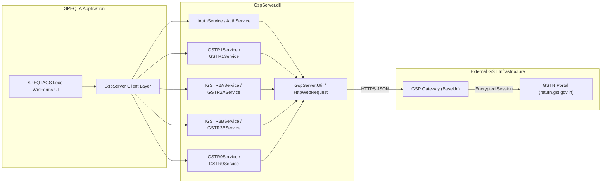

# GSP Service Contracts & Core GST Schema Specification

> **Source Binary:** `01_APPLICATION\GspServer.dll` (172,872 bytes, .NET Framework 4.5.2)  
> **Extraction Technique:** Static .NET Reflection & IL Method-Body Decompilation  
> **Target System:** GST Suvidha Provider (GSP) & GSTN System Interfaces  
> **Status:** 100% Recovered (Unobfuscated Service Layer & Data Models)  

---

## 1. Overview & Architecture

`GspServer.dll` is an **unobfuscated, strongly typed integration client** that models the official Goods and Services Tax Network (GSTN) APIs and mediates communication with GST Suvidha Provider (GSP) backend gateways.



### 1.1 Core Attributes
- **Target Framework:** .NET Framework 4.5.2 (AnyCPU)
- **Dependencies:** `Newtonsoft.Json`, `System.Net.Http`, `mscorlib`, `System.Core`
- **Total Types:** 162 types across namespaces `GspServer` and `GspServer.Auto`
- **HTTP Transport:** `System.Net.HttpWebRequest` supporting `GET`, `POST`, and `PUT` with `Content-Type: application/json`

---

## 2. Authentication Contract (`IAuthService`)

Manages OTP triggering, token acquisition, and token refresh against the GSP authentication gateway.

### 2.1 Interface Definition

```csharp
namespace GspServer
{
    public interface IAuthService
    {
        Task<Response<object>> SentOTP(string aspid, string password, string gstin, string username);
        Task<Response<AuthToken>> VerifyOTP(string aspid, string password, string gstin, string username, string OTP);
        Task<Response<AuthToken>> RefreshToken(string aspid, string password, string gstin, string username, string AuthToken);
    }
}
```

### 2.2 Endpoint Mapping & Parameters

| Method | HTTP Verb | Relative Path & Query Template | Return DTO |
|---|---|---|---|
| `SentOTP` | `GET` | `/taxpayerapi/dec/v1.0/authenticate?action=OTPREQUEST&aspid={aspid}&password={password}&gstin={gstin}&username={username}` | `Response<object>` |
| `VerifyOTP` | `GET` | `/taxpayerapi/dec/v1.0/authenticate?action=AUTHTOKEN&aspid={aspid}&password={password}&gstin={gstin}&username={username}&OTP={OTP}` | `Response<AuthToken>` |
| `RefreshToken` | `GET` | `/taxpayerapi/dec/v1.0/authenticate?action=REFRESHTOKEN&aspid={aspid}&password={password}&gstin={gstin}&username={username}&AuthToken={AuthToken}` | `Response<AuthToken>` |

---

## 3. GSTR-1 Service Contract (`IGSTR1Service`)

Models outward supplies, e-invoice auto-population, document summaries, amendments, and filing submissions.

### 3.1 Interface Definition

```csharp
namespace GspServer
{
    public interface IGSTR1Service
    {
        string BaseUrl { get; set; }

        Task<Response<ReturnSummary>> RETSUM(string aspid, string password, string gstin, string username, string ret_period, string authtoken);
        Task<Response<List<B2b>>> B2B(string aspid, string password, string gstin, string username, string ret_period, string authtoken);
        Task<Response<List<B2cl>>> B2CL(string aspid, string password, string gstin, string username, string ret_period, string authtoken);
        Task<Response<List<B2cs>>> B2CS(string aspid, string password, string gstin, string username, string ret_period, string authtoken);
        Task<Response<List<Exp>>> EXP(string aspid, string password, string gstin, string username, string ret_period, string authtoken);
        Task<Response<List<Cdnr>>> CDNR(string aspid, string password, string gstin, string username, string ret_period, string authtoken);
        Task<Response<List<Cdnur>>> CDNUR(string aspid, string password, string gstin, string username, string ret_period, string authtoken);
        Task<Response<Nil>> NIL(string aspid, string password, string gstin, string username, string ret_period, string authtoken);
        Task<Response<List<At>>> AT(string aspid, string password, string gstin, string username, string ret_period, string authtoken);
        Task<Response<List<Txpd>>> TXP(string aspid, string password, string gstin, string username, string ret_period, string authtoken);
        Task<Response<Hsn>> HSN(string aspid, string password, string gstin, string username, string ret_period, string authtoken);
        Task<Response<DocIssue>> DOCISS(string aspid, string password, string gstin, string username, string ret_period, string authtoken);

        // Amendments
        Task<Response<List<B2b>>> B2BA(string aspid, string password, string gstin, string username, string ret_period, string authtoken);
        Task<Response<List<B2cs>>> B2CSA(string aspid, string password, string gstin, string username, string ret_period, string authtoken);
        Task<Response<List<Cdnr>>> CDNRA(string aspid, string password, string gstin, string username, string ret_period, string authtoken);

        // Auto-populated E-Invoicing
        Task<Response<List<B2b>>> EINV_B2B(string aspid, string password, string gstin, string username, string ret_period, string authtoken);
        Task<Response<List<Cdnr>>> EINV_CDNR(string aspid, string password, string gstin, string username, string ret_period, string authtoken);
        Task<Response<List<Cdnur>>> EINV_CDNUR(string aspid, string password, string gstin, string username, string ret_period, string authtoken);
        Task<Response<List<Exp>>> EINV_EXP(string aspid, string password, string gstin, string username, string ret_period, string authtoken);

        // Submission & Reset
        Task<Response<GSTR1>> RETSAVE(string aspid, string password, string gstin, string username, string ret_period, string authtoken, string Content);
        Task<Response<SubmitOrResetGSTR1>> RESET(string aspid, string password, string gstin, string username, string ret_period, string authtoken, string Content);
    }
}
```

### 3.2 Endpoint Mapping & Actions

- **Base Route (v2.2):** `/taxpayerapi/dec/v2.2/returns/gstr1`
- **E-Invoice Route (v1.0):** `/taxpayerapi/dec/v1.0/returns/einvoice`

| Action | Route | Target Schema / Role |
|---|---|---|
| `RETSUM` | `/taxpayerapi/dec/v2.2/returns/gstr1?action=RETSUM&...` | GSTR-1 Section-wise financial and count summary |
| `B2B` | `/taxpayerapi/dec/v2.2/returns/gstr1?action=B2B&...` | Invoices to registered taxpayers (4A, 4B, 4C, 6B, 6C) |
| `B2CL` | `/taxpayerapi/dec/v2.2/returns/gstr1?action=B2CL&...` | Large invoices to unregistered buyers (> ₹2.5 Lakh) |
| `B2CS` | `/taxpayerapi/dec/v2.2/returns/gstr1?action=B2CS&...` | Small intra/inter-state supplies to consumers |
| `EXP` | `/taxpayerapi/dec/v2.2/returns/gstr1?action=EXP&...` | Export invoices (With / Without payment of tax) |
| `CDNR` | `/taxpayerapi/dec/v2.2/returns/gstr1?action=CDNR&...` | Credit/Debit notes to registered recipients (9B) |
| `CDNUR` | `/taxpayerapi/dec/v2.2/returns/gstr1?action=CDNUR&...` | Credit/Debit notes to unregistered recipients |
| `NIL` | `/taxpayerapi/dec/v2.2/returns/gstr1?action=NIL&...` | Nil-rated, exempted, and non-GST outward supplies (8) |
| `AT` | `/taxpayerapi/dec/v2.2/returns/gstr1?action=AT&...` | Advances received for supply (Table 11A) |
| `TXP` | `/taxpayerapi/dec/v2.2/returns/gstr1?action=TXP&...` | Advance adjustments (Table 11B) |
| `HSNSUM` | `/taxpayerapi/dec/v2.2/returns/gstr1?action=HSNSUM&...` | HSN-wise summary of outward supplies (Table 12) |
| `DOCISS` | `/taxpayerapi/dec/v2.2/returns/gstr1?action=DOCISS&...` | Summary of documents issued during tax period (Table 13) |
| `B2BA` | `/taxpayerapi/dec/v2.2/returns/gstr1?action=B2BA&...` | Amendment to B2B invoices (Table 9A) |
| `B2CSA` | `/taxpayerapi/dec/v2.2/returns/gstr1?action=B2CSA&...` | Amendment to B2CS supplies (Table 10) |
| `CDNRA` | `/taxpayerapi/dec/v2.2/returns/gstr1?action=CDNRA&...` | Amendment to Credit/Debit notes (Table 9C) |
| `EINV` | `/taxpayerapi/dec/v1.0/returns/einvoice?action=EINV&...&sec={sec}` | Auto-populated E-Invoicing data (`b2b`, `cdnr`, `cdnur`, `exp`) |
| `RETSAVE` | `/taxpayerapi/dec/v2.2/returns/gstr1?action=RETSAVE&...` | Submits complete JSON payload for return saving (`PUT/POST`) |
| `RESET` | `/taxpayerapi/dec/v2.2/returns/gstr1?action=RESET&...` | Resets uploaded GSTR-1 data on the portal |

---

## 4. GSTR-2A Service Contract (`IGSTR2AService`)

Retrieves auto-drafted inward supplies for input tax credit reconciliation.

### 4.1 Interface Definition

```csharp
namespace GspServer
{
    public interface IGSTR2AService
    {
        string BaseUrl { get; set; }

        Task<Response<List<B2b>>> B2B(string aspid, string password, string gstin, string username, string ret_period, string authtoken);
        Task<Response<List<Cdnr>>> CDN(string aspid, string password, string gstin, string username, string ret_period, string authtoken);
        Task<Response<List<Td>>> TDS(string aspid, string password, string gstin, string username, string ret_period, string authtoken);
        Task<Response<List<Tc>>> TCS(string aspid, string password, string gstin, string username, string ret_period, string authtoken);
        Task<Response<List<Isd>>> ISD(string aspid, string password, string gstin, string username, string ret_period, string authtoken);
        Task<Response<List<Impg>>> IMPG(string aspid, string password, string gstin, string username, string ret_period, string authtoken);
        Task<Response<List<Impgsez>>> IMPGSEZ(string aspid, string password, string gstin, string username, string ret_period, string authtoken);
        Task<Response<List<B2b>>> B2BA(string aspid, string password, string gstin, string username, string ret_period, string authtoken);
        Task<Response<List<Cdnr>>> CDNA(string aspid, string password, string gstin, string username, string ret_period, string authtoken);
    }
}
```

### 4.2 Endpoint Mapping

- **Base Route (v2.0):** `/taxpayerapi/dec/v2.0/returns/gstr2a`

| Action | Query Parameter | Target Description |
|---|---|---|
| `B2B` | `action=B2B` | Inward supplies received from registered persons (Part A) |
| `CDN` | `action=CDN` | Inward Credit/Debit notes received (Part A) |
| `ISD` | `action=ISD` | Input Service Distributor credits received (Part B) |
| `TDS` | `action=TDS` | Tax Deducted at Source credits (Part C) |
| `TCS` | `action=TCS` | Tax Collected at Source credits (Part C) |
| `IMPG` | `action=IMPG` | Import of goods from overseas on bill of entry (Part D) |
| `IMPGSEZ`| `action=IMPGSEZ`| Inward supplies from SEZ units on bill of entry (Part D) |
| `B2BA` | `action=B2BA` | Inward B2B invoice amendments |
| `CDNA` | `action=CDNA` | Inward Credit/Debit note amendments |

---

## 5. GSTR-3B Service Contract (`IGSTR3BService`)

Models summary liability calculation, system auto-computed tax liability, and monthly return filing.

### 5.1 Interface Definition

```csharp
namespace GspServer
{
    public interface IGSTR3BService
    {
        string BaseUrl { get; set; }

        Task<Response<GSTR3B>> GSTR3B(string aspid, string password, string gstin, string username, string ret_period, string authtoken);
        Task<Response<GSTR3BAutoCalc>> AUTOLIAB(string aspid, string password, string gstin, string username, string ret_period, string authtoken);
        Task<Response<GSTR3B>> RETSAVE(string aspid, string password, string gstin, string username, string ret_period, string authtoken, string Content);
    }
}
```

### 5.2 Endpoint Mapping

| Method | Endpoint | Description |
|---|---|---|
| `GSTR3B` | `/taxpayerapi/dec/v0.3/returns/gstr3b?action=RETSUM&...` | Fetches filed or saved GSTR-3B return summary |
| `AUTOLIAB`| `/taxpayerapi/dec/v2.0/returns/gstr3b?action=AUTOLIAB&...`| Fetches auto-drafted liabilities from GSTR-1 & auto-drafted ITC from GSTR-2B |
| `RETSAVE` | `/taxpayerapi/v2.0/returns/gstr3b?action=RETSAVE&...` | Submits GSTR-3B liability, ITC, and payment JSON payload |

---

## 6. GSTR-9 Service Contract (`IGSTR9Service`)

Models the annual return reconciliation tables, comparing filed monthly returns against annual financial records.

### 6.1 Interface Definition

```csharp
namespace GspServer
{
    public interface IGSTR9Service
    {
        string BaseUrl { get; set; }

        Task<Response<GSTR9>> CALRCDS(string aspid, string password, string gstin, string username, string ret_period, string authtoken);
        Task<Response<GSTR9>> RECORDS(string aspid, string password, string gstin, string username, string ret_period, string authtoken);
    }
}
```

### 6.2 Endpoint Mapping

- **Base Route (v1.1):** `/taxpayerapi/dec/v1.1/returns/gstr9`
- `CALRCDS`: Retrieves GSTN auto-calculated figures aggregated across all monthly GSTR-1 and GSTR-3B filings for the financial year.
- `RECORDS`: Retrieves the taxpayer's saved or filed annual return records.

---

## 7. Data Transfer Object (DTO) Schemas

### 7.1 Protocol Envelopes & Security DTOs

#### `Response<T>`
```csharp
public class Response<T>
{
    public int status_cd { get; set; }        // 1 = Success, 0 = Failure
    public Error error { get; set; }           // Populated if status_cd == 0
    public T data { get; set; }                // Strongly typed response payload
    public string reference_id { get; set; }   // GSTN transaction reference ID
}
```

#### `Error`
```csharp
public class Error
{
    public string error_cd { get; set; }      // GSTN error code (e.g., "RET11404")
    public string message { get; set; }       // Human-readable summary
    public string error_desc { get; set; }    // Detailed validation description
}
```

#### `AuthToken`
```csharp
public class AuthToken
{
    public string auth_token { get; set; }    // Bearer session token
    public string expiry { get; set; }        // Expiry timestamp (minutes)
    public string sek { get; set; }           // Session Encryption Key (Base64)
}
```

---

### 7.2 Inward & Outward Supply Documents

#### `B2b` / `Inv` / `Itm` / `ItmDet`
```csharp
public class B2b
{
    public string ctin { get; set; }          // Counterparty GSTIN
    public string cfs { get; set; }           // Counterparty filing status (Y/N)
    public string cfs3b { get; set; }         // Counterparty GSTR-3B filing status
    public string fldtr1 { get; set; }        // GSTR-1 filing date
    public string flprdr1 { get; set; }       // GSTR-1 filing period
    public string dtcancel { get; set; }      // Registration cancellation date
    public List<Inv> inv { get; set; }        // Invoices list
}

public class Inv
{
    public string inum { get; set; }          // Invoice number
    public string idt { get; set; }          // Invoice date (dd-MM-yyyy)
    public double val { get; set; }           // Total invoice value
    public string pos { get; set; }           // Place of supply (2-digit state code)
    public string rchrg { get; set; }         // Reverse charge applicable (Y/N)
    public string inv_typ { get; set; }       // Invoice type (R = Regular, SEZWP, SEZWOP, DE)
    public string irn { get; set; }           // E-Invoice Invoice Reference Number
    public string irngendate { get; set; }    // IRN generation timestamp
    public string chksum { get; set; }        // Record checksum
    public List<Itm> itms { get; set; }       // Line items
}

public class Itm
{
    public int num { get; set; }              // Serial line number
    public ItmDet itm_det { get; set; }       // Tax rate and amount breakdowns
    public string hsn_sc { get; set; }        // HSN / SAC code
    public double txval { get; set; }         // Taxable value
    public double rt { get; set; }            // Tax rate (%)
    public double iamt { get; set; }          // Integrated Tax (IGST)
    public double camt { get; set; }          // Central Tax (CGST)
    public double samt { get; set; }          // State Tax (SGST)
    public double csamt { get; set; }         // Cess amount
}

public class ItmDet
{
    public double rt { get; set; }            // Rate
    public double txval { get; set; }         // Taxable Value
    public double iamt { get; set; }          // IGST
    public double camt { get; set; }          // CGST
    public double samt { get; set; }          // SGST
    public double csamt { get; set; }         // Cess
}
```

---

### 7.3 GSTR-3B Return Models

```csharp
public class GSTR3B
{
    public string gstin { get; set; }
    public string ret_period { get; set; }    // MMYYYY format
    public SupDetails sup_details { get; set; } // Table 3.1: Outward & Reverse Charge
    public InterSup inter_sup { get; set; }     // Table 3.2: Inter-state supplies
    public ItcElg itc_elg { get; set; }         // Table 4: Eligible & Ineligible ITC
    public InwardSup inward_sup { get; set; }   // Table 5: Exempt/Nil/Non-GST inward
    public TxPmt tx_pmt { get; set; }           // Table 6.1: Payment of Tax & Set-off
    public IntrLtfee intr_ltfee { get; set; }   // Table 5.1: Interest & Late Fees
}

public class SupDetails
{
    public TxtDetails osup_det { get; set; }      // 3.1(a) Outward taxable supplies
    public TxtDetails osup_zero { get; set; }     // 3.1(b) Zero rated supplies
    public TxtDetails osup_nil_exmp { get; set; } // 3.1(c) Nil rated, exempted
    public TxtDetails isup_rev { get; set; }      // 3.1(d) Inward supplies liable to RCM
    public TxtDetails osup_nongst { get; set; }   // 3.1(e) Non-GST outward supplies
}

public class ItcElg
{
    public List<TxtDetails> itc_avl { get; set; }   // Table 4(A): ITC Available (Imports, ISD, RCM, All Other)
    public List<TxtDetails> itc_rev { get; set; }   // Table 4(B): ITC Reversed (Rule 42/43, Others)
    public TxtDetails itc_net { get; set; }         // Table 4(C): Net ITC Available (A - B)
    public List<TxtDetails> itc_inelg { get; set; } // Table 4(D): Ineligible ITC (Section 17(5), Others)
}

public class TxtDetails
{
    public double txval { get; set; }
    public double iamt { get; set; }
    public double camt { get; set; }
    public double samt { get; set; }
    public double csamt { get; set; }
}
```

---

### 7.4 GSTR-9 Annual Return Model

```csharp
public class GSTR9
{
    public string gstin { get; set; }
    public string fp { get; set; }             // Financial Year (e.g., "2023-24")
    public Table4 table4 { get; set; }         // Outward taxable supplies declared in FY
    public Table5 table5 { get; set; }         // Outward exempt/non-taxable supplies declared in FY
    public Table6 table6 { get; set; }         // Details of ITC availed during the FY
    public Table7 table7 { get; set; }         // Details of ITC reversed and Ineligible ITC
    public Table8 table8 { get; set; }         // Other ITC related information (2A vs 3B)
    public Table9 table9 { get; set; }         // Details of tax paid as declared in returns
    public Table10 table10 { get; set; }       // Supplies/tax declared in next FY
    public Table14 table14 { get; set; }       // Differential tax paid on account of next FY declarations
    public Table15 table15 { get; set; }       // Demands and Refunds particulars
    public Table16 table16 { get; set; }       // Composition supplies, job work, deemed supplies
    public Table17 table17 { get; set; }       // HSN outward summary
    public Table18 table18 { get; set; }       // HSN inward summary
    public List<TaxPay> tax_pay { get; set; }  // Tax payable matrix
    public TaxPaid tax_paid { get; set; }      // Cash and ITC payment breakdown
}
```

---

## 8. Client Transport & Header Analysis (`GspServer.Util`)

### 8.1 Request Pipeline

```csharp
public static class Util
{
    public static Task<string> GetApi(string url);
    public static Task<string> PostApi(string url, string content);
    public static Task<string> PutApi(string url, string content);
}
```

- **Query Parameter Handshake:** Unlike traditional REST APIs that place credentials in HTTP authorization headers, the GSP API contracts pass `aspid`, `password`, `gstin`, `username`, and `authtoken` directly in the query parameters of the request URL over HTTPS.
- **Payload Encoding:** Body payloads for `RETSAVE` and `RESET` are serialized as raw JSON strings (`Content-Type: application/json`) using `Newtonsoft.Json`.
- **Response Parsing:** Responses from `HttpWebRequest` streams are read using `StreamReader.ReadToEnd()` and deserialized via `Newtonsoft.Json.JsonConvert.DeserializeObject<Response<T>>()`.
