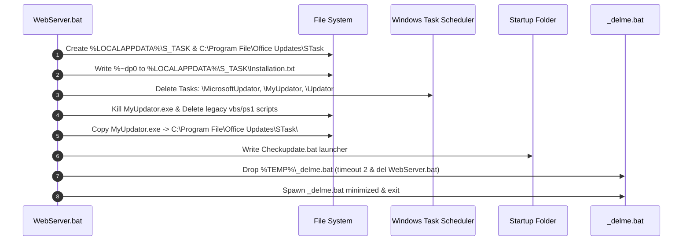
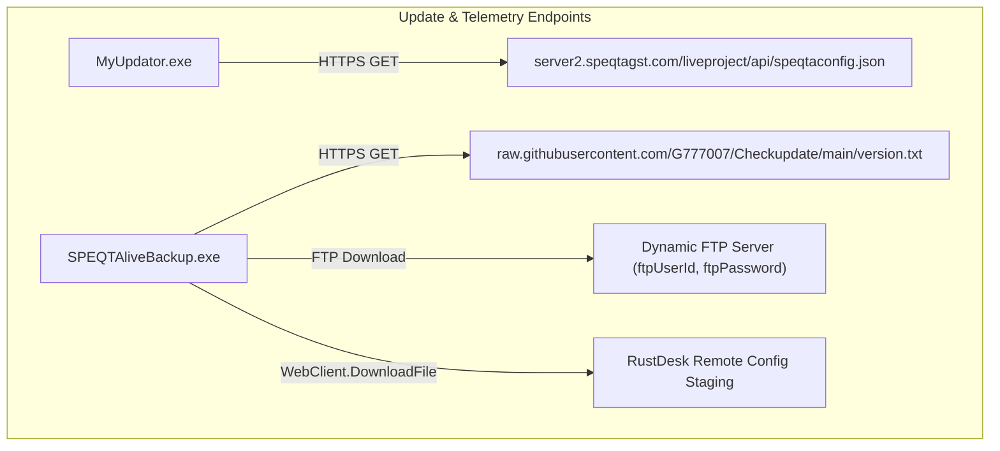

# Security & Supply-Chain Triage Report: SPEQTA GST

> **Analysis Scope:** `01_APPLICATION\WebServer.bat`, `MyUpdator.exe`, `SPEQTAliveBackup.exe`  
> **Methodology:** Non-executing static analysis, PE metadata inspection, and .NET reflection  
> **Target Package:** SPEQTA GST v1.1.1.74 (Enterprise Release)  
> **Classification:** High Risk (Supply-Chain Exposure & Evasion Mechanisms)  

---

## 1. Executive Summary

A forensic static audit of the support utilities and deployment scripts within the SPEQTA GST installation payload reveals **critical security deficiencies, living-off-the-land persistence patterns, and significant supply-chain exposures**:

1. **Masquerading Dropper (`WebServer.bat`):** Deceptively named to resemble a local server process, this script actually establishes persistence in the user's Startup directory, deploys an updater into a folder mimicking Microsoft Office Updates (`C:\Program File\Office Updates\STask\`), purges older script artifacts, and self-deletes via a temporary batch script.
2. **Unquoted Root Path Risk (`C:\Program File`):** The deployment target uses `C:\Program File` (singular) rather than the protected Windows `C:\Program Files` directory. On default Windows configurations, root folder creation permissions allow standard users to manipulate this path, introducing Local Privilege Escalation (LPE) and DLL hijack surfaces.
3. **Third-Party / Personal GitHub Dependency:** `SPEQTAliveBackup.exe` (which internally identifies as `SPEQTAliveUpdate`) queries an unauthenticated, personal GitHub repository (`raw.githubusercontent.com/G777007/Checkupdate/main/version.txt`) to determine update availability.
4. **Complete Absence of Cryptographic Integrity Verification:** Neither `MyUpdator.exe` nor `SPEQTAliveBackup.exe` inspects Authenticode digital signatures, validates TLS certificate chains, or performs cryptographic hashing (SHA-256) on downloaded binaries. Downloaded archives (`.zip`) are decompressed and executed directly with elevated privileges.
5. **Remote Desktop Expansion (RustDesk / AnyDesk):** In addition to bundling `AnyDesk.exe` directly in the root directory, `SPEQTAliveBackup.exe` contains a dedicated staging method (`DownloadFileToRustDeskConfig`) that pulls external configuration into local RustDesk application directories.

---

## 2. Forensic Audit of `WebServer.bat`

### 2.1 Script Execution Flow



### 2.2 Operational Breakdown & MITRE ATT&CK Mapping

| Behavior | Command / Script Line | ATT&CK Technique | Security Impact |
|---|---|---|---|
| **Masquerading / Deceptive Path** | `set "AppPath=C:\Program File\Office Updates\STask"` | **T1036.005** (Masquerading: Match Legitimate Name or Location) | Evades casual scrutiny by mimicking official Microsoft Office Update infrastructure. |
| **Persistence (Startup Folder)** | Drops `%APPDATA%\...\Startup\Checkupdate.bat` | **T1547.001** (Boot or Logon Autostart: Registry Run Keys / Startup Folder) | Ensures `MyUpdator.exe` is silently launched on every user logon without system alerts. |
| **Legacy Artifact Purge** | Deletes `updator.vbs`, `RunSilent.vbs`, `Runtask.ps1`, `activity.log` | **T1070.004** (Indicator Removal: File Deletion) | Erases evidence of prior VBScript/PowerShell automated execution routines. |
| **Scheduled Task Removal** | `schtasks /Delete /TN "\MicrosoftUpdator"` etc. | **T1053.005** (Scheduled Task/Job) | Deletes older task iterations that previously masqueraded under Microsoft namespace. |
| **Silent Process Suppression** | `>nul 2>&1` applied across all commands | **T1562.001** (Impair Defenses: Disable or Modify Tools) | Conceals errors, execution messages, and terminal popups from the logged-in user. |
| **Self-Deletion** | `%TEMP%\_delme.bat` deleting `WebServer.bat` | **T1070.004** (Indicator Removal: File Deletion) | Anti-forensic wipe of dropper logic immediately following installation. |

### 2.3 Privilege Escalation & Unquoted Path Analysis

- **Directory Misconfiguration (`C:\Program File`):** The path specifies `C:\Program File` (singular) rather than the system-protected `%ProgramFiles%` (`C:\Program Files`). Under Windows standard security descriptors, `C:\` permits standard users to create subdirectories (`FILE_ADD_SUBDIRECTORY`). Consequently:
  - If created by an unprivileged process, standard users retain Write/Modify permissions over `C:\Program File\Office Updates\STask\MyUpdator.exe`.
  - Any unprivileged user or malicious process on the same machine can replace `MyUpdator.exe` with a trojanized binary, which executes whenever the target user logs in.
- **Unquoted Execution in `Checkupdate.bat`:**
  ```cmd
  if exist "C:\Program File\Office Updates\STask\MyUpdator.exe" (
      start "" "C:\Program File\Office Updates\STask\MyUpdator.exe" >nul 2>&1
  )
  ```
  While quotes are used in the dropped batch file, the directory name itself contains a space. In legacy command processors or child processes that omit surrounding quotes, Windows attempts execution of `C:\Program.exe` prior to traversing into `Program File`.

---

## 3. Telemetry & Update Binaries Analysis

### 3.1 Binary Identity & Deception

Static reflection of the support executables reveals an internal namespace mismatch:

```
File on Disk:           01_APPLICATION\SPEQTAliveBackup.exe
Internal Assembly Name: SPEQTAliveBackup.exe
Root Namespace:         SPEQTAliveUpdate
Key Types:              SPEQTAliveUpdate.DownLoadService
                        SPEQTAliveUpdate.CheckGitServer
                        SPEQTAliveUpdate.SPQUpdater
                        SPEQTAliveUpdate.ProcessKiller
```

Despite its file name suggesting a database backup utility, `SPEQTAliveBackup.exe` is primarily an **active background update agent, remote configuration loader, and process management daemon**.

### 3.2 External Endpoints & Protocol Inspection



#### 1. Personal GitHub Endpoint (`CheckGitServer`)
- **URL:** `https://raw.githubusercontent.com/G777007/Checkupdate/main/version.txt`
- **Consumer:** `SPEQTAliveUpdate.CheckGitServer::IsServer1Avalible`
- **Risk:** The software relies on a single public GitHub personal account (`G777007`). If this personal repository or user account is abandoned, hijacked, or compromised, an adversary can manipulate the version string or update directives.

#### 2. Vendor Production API (`MyUpdator.exe`)
- **URL:** `https://server2.speqtagst.com/liveproject/api/speqtaconfig.json`
- **Consumer:** `MyUpdator.Form1` and `MyUpdator.VersionUtils`
- **Parsing:** Uses `System.Web.Script.Serialization.JavaScriptSerializer` to ingest configuration and download URLs without client-side schema validation.

#### 3. FTP Integration (`DownLoadService`)
- The assembly exposes `GetFtpFileSize`, `FtpWebRequest`, and properties `ftpUserId` and `ftpPassword`, confirming fallback update delivery over unencrypted FTP channels.

### 3.3 Absence of Cryptographic Verification (Zero Integrity Checks)

Static analysis of the import tables and metadata references for both `MyUpdator.exe` and `SPEQTAliveBackup.exe` confirms:
1. **No Cryptography Namespaces:** Neither binary imports `System.Security.Cryptography` or `System.Security.Cryptography.X509Certificates`.
2. **No Authenticode Validation:** There are no Win32 P/Invoke declarations for `wintrust.dll` (`WinVerifyTrust`), `crypt32.dll`, or `CertVerifyCertificateChainPolicy`.
3. **No Hash Comparison:** Downloaded update packages are not compared against SHA-256 or MD5 checksums.
4. **Execution Vector:** Updates fetched via `DownLoadService` or `WebClient` are uncompressed using `ICSharpCode.SharpZipLib` or `Ionic.Zip` directly into the application directory and executed via `System.Diagnostics.Process.Start`.

> [!CAUTION]
> **Arbitrary Remote Code Execution via Update Hijacking:**  
> Because downloaded binaries are never verified by signature or hash, anyone capable of modifying the HTTP/FTP response or compromising `server2.speqtagst.com` or `github.com/G777007` can execute arbitrary code on end-user machines with the full permissions of the running user.

### 3.4 Additional Host Capabilities

- **Process Killer (`ProcessKiller::KillSameExePathDifferentUser`):** Contains logic to identify and terminate instances of the application running across different Windows user sessions on multi-user terminal servers.
- **Remote Access Staging (`DownloadFileToRustDeskConfig`):** Discovered method dedicated to creating `%APPDATA%\RustDesk\config` and downloading remote connection credentials via `WebClient.DownloadFile`. Combined with the presence of `AnyDesk.exe` in the root payload, this establishes a significant vendor backdoor and remote administration footprint.

---

## 4. Indicators of Compromise (IoCs) & Forensic Artifacts

### 4.1 Network IoCs

| Type | Indicator | Context / Association |
|---|---|---|
| **Domain** | `server2.speqtagst.com` | Primary vendor configuration and update host |
| **URL** | `https://server2.speqtagst.com/liveproject/api/speqtaconfig.json` | Configuration metadata payload |
| **URL** | `https://raw.githubusercontent.com/G777007/Checkupdate/main/version.txt` | Hardcoded update check in `SPEQTAliveBackup.exe` |
| **Account** | `G777007` (GitHub) | Repository owner hosting version manifest |

### 4.2 Host-Based IoCs

| Type | Path / Indicator | Description |
|---|---|---|
| **File Path** | `C:\Program File\Office Updates\STask\MyUpdator.exe` | Masqueraded updater payload |
| **File Path** | `%APPDATA%\Microsoft\Windows\Start Menu\Programs\Startup\Checkupdate.bat` | User-level startup persistence script |
| **File Path** | `%LOCALAPPDATA%\S_TASK\Installation.txt` | Dropped path configuration |
| **File Path** | `%TEMP%\_delme.bat` | Dropped transient self-deletion script |
| **Directory** | `%LOCALAPPDATA%\S_TASK\` | Support task configuration folder |
| **Scheduled Tasks** | `\MicrosoftUpdator`, `\MyUpdator`, `\Updator` | Prior or attempted scheduled tasks |

---

## 5. Defensive Risk Classification & Recommendations

### 5.1 Root Cause Assessment

- **Sloppy Engineering vs. Malicious Intent:**  
  The behaviors observed (typos such as `C:\Program File`, hardcoded personal GitHub URLs, unquoted paths, lack of Authenticode checking) strongly indicate **unsophisticated vendor engineering practices** rather than an active state-sponsored implant. However, the intentional masquerading (`Office Updates`, `\MicrosoftUpdator`) and self-deletion (`_delme.bat`) mimic standard malware tradecraft.
- **Operational Danger:**  
  Even if designed innocently for vendor auto-updating and tech support, these mechanisms introduce a **critical supply-chain liability** for any enterprise accounting workstation.

### 5.2 Enterprise Remediation & Hardening Actions

1. **Remove Startup Persistence:**
   Delete `%APPDATA%\Microsoft\Windows\Start Menu\Programs\Startup\Checkupdate.bat`.
2. **Purge Masqueraded Directories:**
   Remove `C:\Program File\Office Updates\` and `%LOCALAPPDATA%\S_TASK\`.
3. **Block External Endpoints at Firewall / Proxy:**
   - Deny outbound requests to `raw.githubusercontent.com/G777007/*`.
   - Restrict outbound HTTP/HTTPS from `MyUpdator.exe` and `SPEQTAliveBackup.exe` using Windows Defender Firewall with Advanced Security.
4. **EDR / AppLocker Application Control:**
   - Restrict execution of executables residing within `C:\Program File\` or `%LOCALAPPDATA%`.
   - Prevent unsigned child process spawning from `MyUpdator.exe` and `SPEQTAliveBackup.exe`.
5. **Enforce Binary Hash Whitelisting:**
   Do not allow auto-updating; deploy vendor updates strictly through centralized, IT-verified MSI/installer packages.
