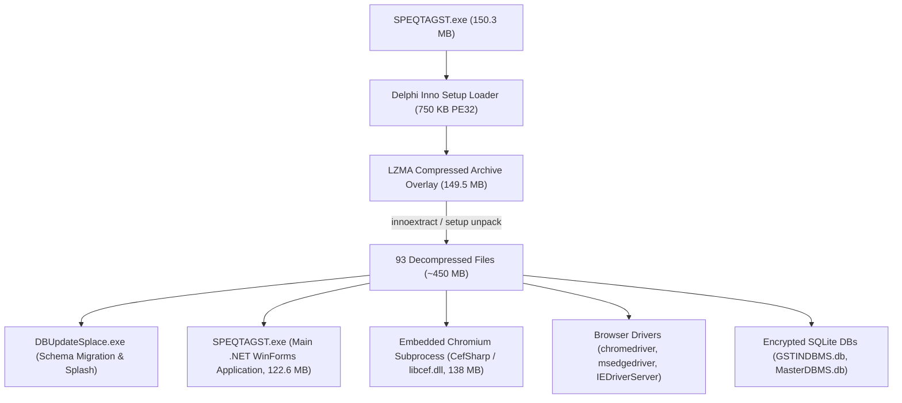
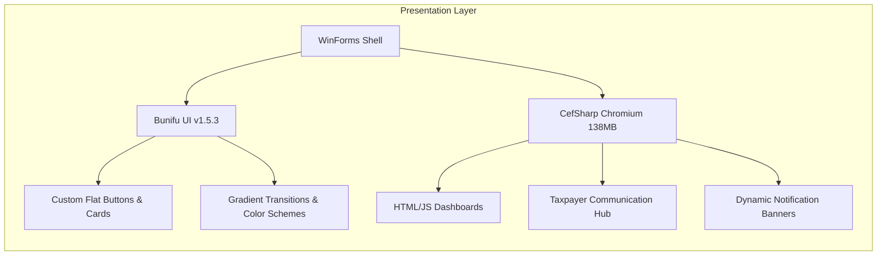
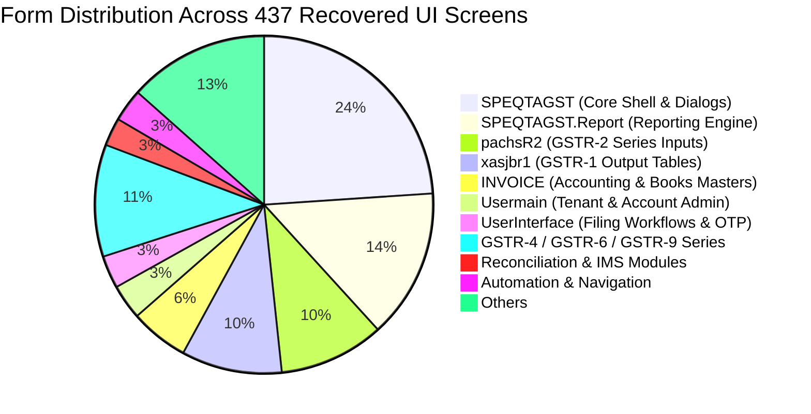
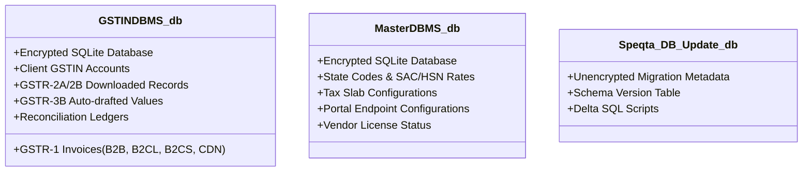
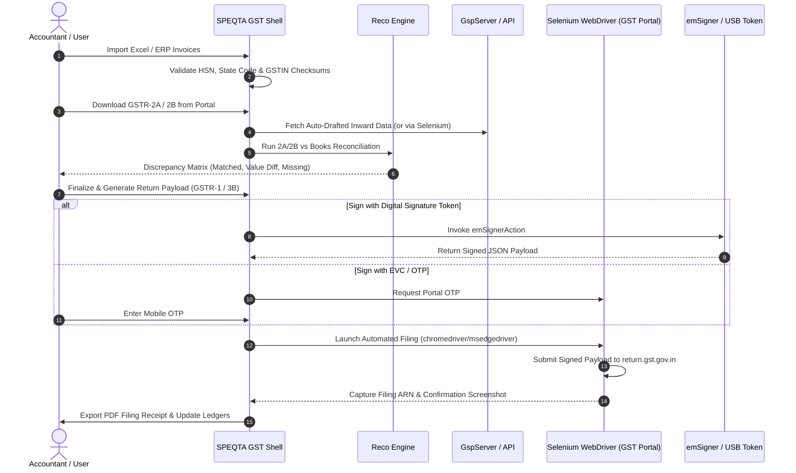
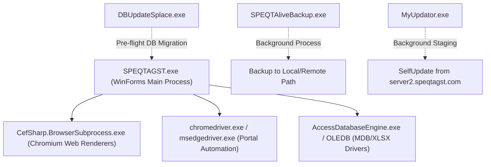

# SPEQTA GST: Full Architecture, UI/UX, Backend, Workflows & Execution Review

> **Target Application:** SPEQTA GST (SPEQTA TAXSOFT AND COMPLIANCE LLP)  
> **Installer Version:** 1.1.1.74 (`SPEQTAGST.exe`, 150.34 MB)  
> **Target Environment:** Windows Desktop (PE32 / x86, .NET Framework 4.x / WinForms)  
> **Workspace Scope:** Enterprise Architecture Assessment  
> **Review Date:** November 2026  

---

## 1. Directory & Workspace Anatomy

The assessment workspace encompasses three primary operational layers: the original installer executable, the extracted application payload, the comprehensive unlocked intelligence package, and the reverse-engineering framework **REA** (`morluto/rea`).

```
speqta-gst-assessment/
├── SPEQTAGST.exe                     # 150.3 MB Original Inno Setup 6.3.0 installer
├── SPEQTAGST_application_payload\     # Complete 93-file unpacked application payload (~450 MB)
│   └── 01_APPLICATION\               # Shipped binaries, runtimes, DBs, and automation drivers
├── SPEQTAGST_unlocked_analysis\       # Structural reverse-engineering package
│   ├── 00_START_HERE.md              # Quickstart and headline findings
│   ├── 02_UI_UX\                     # Form catalog (437 forms), control mappings, 1,537 images
│   ├── 03_STRINGS\                   # 520,000 harvested strings, endpoints, paths, UI text
│   ├── 04_METADATA\                  # Assembly manifests and resource mappings
│   ├── 05_DOCS\                      # Technical documentation (Architecture, UI, Data, Workflows)
│   └── 06_TOOLS\                     # Extraction and carving scripts (`rs.py`, `extract_resources.py`)
├── rea\                              # Cloned 'Reverse Engineer Anything' v6.9.0 repository
│   ├── bridge\                       # Hopper, Cutter, LLDB, and native instrumentation bridges
│   ├── src\                          # Core MCP servers, disassembly agents, and analysis workers
│   └── package.json                  # Node.js / TypeScript CLI & MCP definition
├── analyze_pe.py / analyze_pe2.py    # Custom Python PE header parsing scripts
├── check_pe.ps1 / extract_strings.ps1# Diagnostic PowerShell scripts
└── SPEQTAGST_Analysis.md             # Initial PE header and section analysis report
```

---

## 2. Codebase & System Architecture

### 2.1 Multi-Stage Delivery Architecture

The application is distributed as a single monolithic executable (`SPEQTAGST.exe`), which acts as an Inno Setup 6.3.0 container:



### 2.2 Vendor Assemblies vs. Dependencies

Out of 93 deployed files, **11 assemblies** contain custom vendor code. The remaining ~82 files comprise third-party runtimes, native C++ shims, and UI libraries.

| Assembly | File Size | Types / Methods | Primary Role | Obfuscation State |
|---|---|---|---|---|
| `SPEQTAGST.exe` | 122.6 MB | 5,745 types / ~128.6K methods | Core application shell & all 437 WinForms | Renamed (Unicode junk), Manifest names preserved |
| `SpeqtaInvoice.dll` | 28.1 MB | ~1,200 types | Invoicing & books accounting engine | Renamed (Unicode junk) |
| `SpeqtaPDConfig.dll` | 15.3 MB | 626 types | Configuration & plugin settings store | Renamed (Unicode junk) |
| `WinAppAutom.dll` | 7.6 MB | ~340 types | Native UI automation & scraping hooks | Renamed (Unicode junk) |
| `SPEQTAliveBackup.exe` | 2.3 MB | ~110 types | Background scheduled backup utility | Partially obfuscated |
| `DBUpdateSplace.exe` | 665 KB | ~45 types | Database updater & splash launcher | Renamed (Unicode junk) |
| `GspServer.dll` | 173 KB | 162 types | GST Suvidha Provider (GSP) API client | **Clean / Unobfuscated** |
| `Proactive.CustomTools.dll`| 110 KB | 36 types | DSC token signing (`emSignerAction`) | Partially obfuscated |
| `MyUpdator.exe` | 93 KB | 30 types | Self-updater & update staging utility | Renamed (Unicode junk) |
| `SPEQTADbRepair.exe` | 75 KB | 18 types | Local SQLite repair utility | Renamed (Unicode junk) |
| `DateValidation.dll` | 9.5 KB | 4 types | Date & financial period validation | Renamed (Unicode junk) |

### 2.3 Obfuscation & Structural Leakage Analysis

The vendor applied an identifier-renaming obfuscator (likely ConfuserEx or a commercial variant):
1. **Symbol Virtualization:** Method, field, parameter, and class names were replaced with non-printable and high Unicode characters (U+2000–U+2FFF range, e.g., `` `2``, ` `3`, `‐`1`).
2. **The Metadata Leak:** WinForms relies on `System.Resources.ResourceManager` which binds directly to the type's fully qualified namespace string at runtime. Because renaming resource files would break visual inheritance and designer bindings, the obfuscator **left all `.resources` names intact**.
3. **The Unobfuscated Service Layer:** `GspServer.dll` was shipped completely unobfuscated. It contains pure C# interfaces (`IGSTR1Service`, `IGSTR2AService`, `IGSTR3BService`, `IGSTR9Service`) and complete DTOs representing the entire Indian GST filing schema.

---

## 3. UI/UX Presentation Layer

### 3.1 Framework Composition

The user interface combines a heavy commercial WinForms component suite with embedded Chromium webviews:



- **Bunifu UI v1.5.3:** Provides the visual identity (curved edges, card layouts, animated transitions, custom headers, and flat controls).
- **CefSharp Chromium (`libcef.dll`, 138 MB):** An embedded browser engine used for rich HTML/JS-based dashboards, the in-app helpdesk, and real-time banner notices (`Notification.xml`).
- **437 Total Forms:** Detailed in `02_UI_UX/form_inventory.csv`, spanning every GST filing category.

### 3.2 Module Breakdown of UI Forms



### 3.3 Visual Asset Extraction

The extraction process recovered **1,537 embedded images** (`02_UI_UX/images/`):
- Action icons (Save, Import Excel, Export JSON, Validate, Portal Login).
- Government & standard tax logos (GSTN, E-Way Bill, E-Invoice, CBIC).
- Dynamic status glyphs (Matched, Unmatched, Mismatched, Pending, Signed).
- Custom splash screens and dialog banners.

---

## 4. Backend, Data Storage & Encryption Model

### 4.1 Local Database Architecture

The application persists all user configurations, client accounts, invoices, and filing history locally using SQLite 3:



### 4.2 Database Encryption Vulnerability

Both `GSTINDBMS.db` (485 KB) and `MasterDBMS.db` (329 KB) are encrypted at rest. However, cryptographic analysis of the files reveals an identical 16-byte file header:

```
GSTINDBMS.db:  fd 0b d6 0a a3 89 1b da 48 b8 b3 a5 a8 ae 7c 21 | f7 89 e7 3c ...
MasterDBMS.db: fd 0b d6 0a a3 89 1b da 48 b8 b3 a5 a8 ae 7c 21 | f7 89 e7 3c ...
               |<- Identical 16-byte fixed IV ->|                 |<- Ciphertext ->|
```

> [!WARNING]
> **Static Initialization Vector (IV):** The first 16 bytes are identical across all databases and installations. This demonstrates that the encryption does not use randomized salts or per-database IVs. It uses AES-CBC with a hardcoded IV and a static key compiled directly into the application code (`SPEQTAGST.exe` or `SpeqtaPDConfig.dll`).

### 4.3 Data Exchange & Interop Engines

| Engine | Assemblies | Responsibilities |
|---|---|---|
| **Excel Ingestion/Export** | `ClosedXML.dll`, `DocumentFormat.OpenXml.dll`, `ExcelDataReader.dll`, `FastMember.dll` | High-speed ingestion of multi-sheet ERP and accounting Excel exports; generating filing workbooks. |
| **PDF Generation** | `itextsharp.dll`, `itextsharp.pdfa.dll` | Generating official client tax invoices, reconciliation reports, and filing receipts. |
| **JSON Serialization** | `Newtonsoft.Json.dll` | Building schema-compliant GSTN JSON payloads for GSTR-1, 3B, 9, and e-invoices. |
| **Digital Signature (DSC)**| `Proactive.CustomTools.dll` | Hardware USB crypto-token interfacing via `DSCSign.emSignerAction` and PKCS#7 / X.509 signing. |

---

## 5. End-to-End Workflows & Business Execution

### 5.1 The Master Filing Lifecycle

The core loop orchestrates accounting data from raw ERP entries to certified filing on the government servers:



### 5.2 Browser Automation Mechanics (`SPQ.Automation`)

Unlike cloud-native GSPs that rely exclusively on API gateways, SPEQTA GST implements **full browser automation** using Selenium WebDriver:
- Ships with all three major drivers: `chromedriver.exe` (v126+), `msedgedriver.exe`, and `IEDriverServer.exe`.
- Bypasses API limitations or outages by navigating to `return.gst.gov.in` directly.
- Handles automated login sequences, CAPTCHA rendering to user dialogs (`SPQGstLogin`), OTP interception (`SPQEVCOTP`), and tax liability offset confirmation (`SPQReturnSetOffConfirmation`).

---

## 6. Execution Lifecycle, Runtime Orchestration & Security Findings

### 6.1 Multi-Process Execution Tree

During normal operation, the system runs as a coordinated tree of processes:



### 6.2 Stealth Update & Persistence Mechanism (`WebServer.bat`)

An analysis of `WebServer.bat` found inside `01_APPLICATION\` reveals a covert persistence mechanism used by the vendor's updater:

1. **Masquerading Folder Path:**
   `WebServer.bat` creates a deceptive directory structure:
   ```cmd
   set "AppPath=C:\Program File\Office Updates\STask"
   set "toolName=MyUpdator.exe"
   ```
2. **Task Hijacking & Cleanup:**
   It checks for and forcibly deletes existing scheduled tasks named `\MicrosoftUpdator`, `\MyUpdator`, and `\Updator`.
3. **Startup Linkage:**
   It drops a batch file named `Checkupdate.bat` in `%APPDATA%\Microsoft\Windows\Start Menu\Programs\Startup` to ensure `MyUpdator.exe` executes on every user login.
4. **Self-Deletion:**
   It drops `_delme.bat` in `%TEMP%` to destroy `WebServer.bat` immediately upon completion.

### 6.3 External Telemetry & GitHub Dependency

String inspection revealed two active external endpoints contacted by the background update services:
1. `https://server2.speqtagst.com/liveproject/api/speqtaconfig.json` (Vendor production server for feature flags and configuration).
2. `https://raw.githubusercontent.com/G777007/Checkupdate/main/version.txt` (Hardcoded inside `SPEQTAliveBackup.exe` to check for version updates via a personal GitHub repository).

### 6.4 Bundled Remote Support Client

`AnyDesk.exe` (5.3 MB) is bundled directly in the application payload directory. While commonly used for remote technical support by Indian tax software vendors, its unattended configuration presents an attack surface if leveraged maliciously.

---

## 7. Reverse-Engineering Roadmap & REA Integration

The repository `morluto/rea` (version 6.9.0) cloned into the workspace provides a native Model Context Protocol (MCP) server and CLI for automated binary analysis.

### Immediate Next Steps to Complete Deobfuscation:

1. **Database Key Recovery:**
   Using ILSpy or dnSpy on the Windows host, inspect the static constructor of `SpeqtaPDConfig.dll` or the SQLite connection factory in `SPEQTAGST.exe`. Search for references to `"GSTINDBMS.db"` or the `SQLiteConnection` connection string parameter `Password=`.
2. **Decrypt SQLite Databases:**
   Once the passphrase/key is extracted from IL, strip the 16-byte fixed IV (`fd 0b d6 0a a3 89 1b da 48 b8 b3 a5 a8 ae 7c 21`) and decrypt using AES-128/256-CBC, restoring full access to the master tax rates and schema structures.
3. **Automated Decompilation via REA:**
   Leverage REA's decompiler worker pipeline (`rea` CLI) or ILSpy CLI (`ilspycmd`) to decompile `GspServer.dll` and `SpeqtaPDConfig.dll` into structured, human-readable C# source projects.
4. **Symbol Reconstruction:**
   Map the decompiled forms back to their original names using `02_UI_UX/form_inventory.csv` and cross-reference control names with `02_UI_UX/form_controls.json`.
